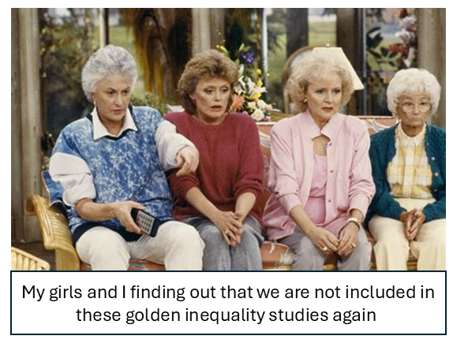

In my [dissertation](https://ora.ox.ac.uk/objects/uuid:74763cc3-e58c-4581-abe3-ce542e8774fd) I explore through which mechanisms Gender Pension Gaps are related to work-family life course patterns or specific aspects of work and family lives. 

Women in Europe receive much less pension income compared to men. Based on the life course perspective and the pertinent gender literature I argue that previous approaches risk concealing complex inequality (re)producing mechanisms that arise over the life course and shape these Gender Pension Gaps (GPG). Particularly, the existing empirical literature on GPGs lacks a multidimensional, gender- and life-course-sensitive analysis by focussing predominantly on the impact of employment. This thesis aims to implement novel methodological approaches to analyse gendered pension income inequalities considering gendered life course complexities and contribute empirically to our understanding of how GPGs unfold.

I apply Sequence analysis, decomposition, and feature selection techniques to assess and quantify the relation between gendered work-family life courses, or specific life course aspects, with gendered pension income inequality. Comparing the analyses across country contexts or pension types reveals how these associations are channelled through different pension designs.

The results reveal that, independently of the pension system and methods applied, the overarching driver of the GPGs is the large amount of unpaid care work that only women performed over their life courses and that is not equivalently rewarded in pension systems compared to other activities. Particularly, typical life courses with strong interdependences between family and work are only experienced by mothers and are highly associated with GPGs. In other words: gendered pension inequality emerges due to an interaction of i) welfare state contexts of the 20th century which incentivised a traditional gendered division of labour and gender inequalities arising therefrom, with ii) pension policies rewarding gendered life courses emerging from it highly unequally nowadays. I conclude that pension policymakers must consider this intertemporal interaction of present pension designs and past welfare state policies for pension reforms if they aim to prevent a severe reproduction of accumulated gender inequalities in old age.

### Dissertation & awards



- **2026:** Young Scientist Award for the dissertation, German Society for Demography (DGD)
- **2025:** [Research award for the dissertation (FNA-Forschungspreis)](https://www.fna-rv.de/DE/Inhalt/02_Foerderungen/02-3_Der_FNA-Forschungspreis/Preistraegerinnen-Preistraeger/Einzelvorstellung/2025_Rowold) of the Research Network on Old-Age Provision (FNA), German Pension Insurance (Deutsche Rentenversicherung)
- **2024:** Final nominee for the Netspar Thesis Award

  <video controls preload="metadata" playsinline poster="/files/videos/final_fna_rowold_poster.jpg">
    <source src="/files/videos/final_fna_rowold.mp4" type="video/mp4">
    Your browser does not support embedded videos. <a href="/files/videos/final_fna_rowold.mp4">Download the video</a>.
  </video>
  
Video from the award of the FNA research prize 2025 of the German Pension Insurance (in German). More on the award on the <a href="https://www.fna-rv.de/DE/Inhalt/02_Foerderungen/02-3_Der_FNA-Forschungspreis/Preistraegerinnen-Preistraeger/Einzelvorstellung/2025_Rowold">FNA website</a>.

A German summary of the main findings and their policy implications is available as a [blog post](/posts/2025/12/blogpost_Rentenlücke/) and as a [PDF summary of the dissertation](/files/Rowold_2024_Gender_Pension_Gaps_Zusammenfassung.pdf).

Published
======

### Differences in Gender Pension Gaps in public and private pensions in West Germany: An analysis sensitive to interdependencies across the life course

*Work, Employment and Society* (2026)

> How are work-family life courses associated with the Gender Pension Gap (GPG)? Do these mechanisms vary between the gender gap in public compared to private pensions? I assess these questions by applying an innovative combination of the Multichannel Sequence Analysis with the Kitagawa-Blinder-Oaxaca decomposition and linking survey to register data for Germany to decompose GPGs based on work-family life courses. Additionally, I decompose GPGs based on the relative earning positions of individuals over the life course. Differentiating between pension types sheds light on the impact of pension privatization and provides more targeted suggestions for policy makers. The results reveal that gender differences in life course patterns mirroring gender inequalities of current cohorts in labour force (e.g. Gender Wage Gap) drive the GPG in private pensions to a higher extent than the gap in public pensions highlighting the risk of high GPGs in the future.



### Full-time employment is all that matters? Quantifying the role of relevant and gender-exclusive life-course experiences for gender pension gaps

*Social Forces* (2026)

> Gender pension gaps (GPGs) represent crucial indicators of gender inequalities over the life course. Despite reaching higher levels, they have received less attention than other gender inequalities, such as gender wage gaps. More generally, research typically focuses on selected sets of life course summary measures, predominantly the employment duration, to explain gender inequalities across the life course. This oversimplifies gender-specific life courses in particular.
>
> Taking a life-course perspective and using data from the Survey of Health, Ageing, and Retirement in Europe for the Netherlands and West Germany, I propose an innovative combination of machine learning, sequence analysis, and decomposition techniques, allowing for a new perspective on gender inequalities over the life course. The study disentangles which specific life-course elements are most relevant for pension inequalities and quantifies the role of gender-exclusive life-course experiences for gender disparities.
>
> I find that the duration, timing, order of life-course events, and overall life-course complexity matter for pension income inequalities in both pension systems. Specifically, the duration, timing, and order of care work experiences are more crucial pension predictors than the employment duration, which has been the primary focus of previous research. This holds for the GPGs: the largest shares are attributable to gender-exclusive life-course experiences because of the lack of a male counterpart for female engagement in care work, which is poorly rewarded in pension systems. Future research and policymakers will benefit from considering such gender-specific combinations of life-course experiences for the gender pension gap and other inequalities.



The video link leads to a recorded presentation of the paper (from minute 55:45).



### Life-course-sensitive analysis of group inequalities: Combining sequence analysis with the Kitagawa-Oaxaca-Blinder decomposition

*With Emanuela Struffolino & Anette Fasang* · *Sociological Methods & Research* (2025)

> Processes that unfold over individuals’ life courses are often associated with inequalities later in life. The literature lacks methodological approaches to analyze inequalities in outcomes between groups, for example, between women and men, in a life-course-sensitive manner. We propose a combination of methods—of sequence analysis, which enables us to study the multidimensional complexity of life courses with Kitagawa–Oaxaca–Blinder decomposition. This approach allows us to distinguish the share of inequalities between groups that is due to group-specific life courses from the share that is due to group-specific returns to similar life courses. We illustrate the combination of the two methods by analyzing work–family life courses and gender pension gaps in Italy and Germany. Our contribution is to systematically compare possible core analytical choices when combining typologies derived using sequence analysis with the Kitagawa–Oaxaca–Blinder decomposition. For future applications, we propose a set of practical guidelines for sequence analysis–Kitagawa–Oaxaca–Blinder decomposition.



Under review
======

### Earning, deriving, or depending? Women’s life courses and pathways to financial security in later life in West Germany and the Netherlands

*With Clara Overweg & Anette Eva Fasang* · Conditionally accepted at *Journal of European Social Policy*

Work in progress
======

### Exploring the role of life course trajectories in the Gender Pension Gap through sequence analysis and nonparametric decomposition

*With Fabian Kratz & Emanuela Struffolino* · Presented at the ECSR Annual Conference 2025

